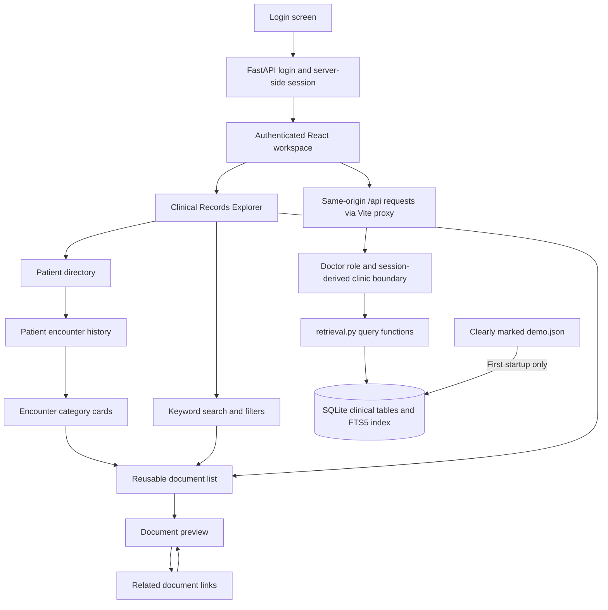

# ClinIQ: Week 5 Information Retrieval Implementation

Implementation and verification date: **19 October 2026** (Asia/Karachi).

## A. Project overview

ClinIQ's **Clinical Records Explorer** retrieves and organizes fictional clinical information for an authorized doctor. It implements all seven Week 5 requirements: an IR home page, category hierarchy, document list, search and browse access, breadcrumbs, related document links, and document previews.

The original workspace contained the project brief and lecture PDFs, without application source. Following the user's revised instruction, this is a **new standalone assignment application** with a separate frontend and backend. It does not claim integration with an existing ClinIQ FYP repository. Every source file listed below is new. The supplied PDFs remain unchanged.

The checked-in dataset contains **2 clinics, 3 users, 9 patients, 10 encounters, 6 categories, and 26 documents**. Northstar has 7 patients, 8 encounters, and 23 documents; Riverside has 2 patients, 2 encounters, and 3 documents. All names, observations, lab values, and clinical notes are fictional and visibly marked as development data. No diagnostic model is implemented.

## B. IR models

| Model | Academic meaning | Actual implementation |
| --- | --- | --- |
| Flat browsing | Inspect a collection without following a hierarchy. | **All Documents** and the reusable `DocumentList` display records directly, with category filters, date/title sorting, and pagination. Each title and Preview action opens the original record. |
| Structured guided browsing | Move from broad organizational levels toward individual information objects. | **Explorer → Patients → Patient → Encounter → Category → Document**. `Patients`, `PatientDetail`, `EncounterDetail`, and `CategoryGrid` implement each level. Clickable breadcrumbs return to parent levels. |
| Hypertext browsing | Follow explicit links between related information objects. | `RelatedDocuments` shows records belonging to the same patient. Same-encounter records appear first; other encounters follow. Clicking a link opens the corresponding authorized preview. |
| Keyword search | Express an information need as a query and retrieve matching documents. | A search box sends normalized words to SQLite FTS5. Titles, note text, category metadata, patient identifiers/names, and encounter identifiers are indexed. Relevance uses weighted BM25. Search can be combined with category or encounter filters. |

Browsing works without typing a query. Searching complements all three browsing models. The in-app **Explorer Guide** demonstrates these distinctions.

## C. Architecture

**Frontend:** React 19, TypeScript, React Router, Vite, CSS, and Lucide icons. **Backend:** Python 3.12 and FastAPI. **Database:** SQLite via Python's `sqlite3`, with FTS5. There is no ORM, external search server, cloud service, AI pipeline, or duplicate clinical document store.

The frontend runs on `127.0.0.1:5173`; the backend runs on `127.0.0.1:8000`. Vite proxies `/api` to the backend. Cookies remain same-origin without a permissive CORS policy. Backend authorization does not depend on frontend filters.

## D. Seven-requirement feature mapping

Paths in this document are relative to the **`cliniq-ir/` project root**. Line numbers below refer to the verified source files.

| IR Feature | Exact Repository File Path | Important Component/Function | Purpose and demonstration |
| --- | --- | --- | --- |
| Home Page | `frontend/src/pages/Explorer.tsx:18` | `Explorer` | Route `/`: heading, search, actual counts, category cards, patient entry point, recent records, loading/error/empty feedback. |
| Category Hierarchy | `frontend/src/pages/Patients.tsx:19`; `frontend/src/pages/Patients.tsx:112`; `frontend/src/pages/Patients.tsx:211`; `frontend/src/components/CategoryGrid.tsx:21` | `Patients`, `PatientDetail`, `EncounterDetail`, `CategoryGrid` | Select a patient, encounter, and category. Selection changes the API filter. Empty categories remain browsable. |
| Document List | `frontend/src/components/DocumentList.tsx:7`; `frontend/src/pages/Records.tsx:11` | `DocumentList`, `RecordsBrowser` | Flat browsing with title, excerpt, patient/encounter, category, date, working preview links, filters, sort, and pagination. |
| Search | `frontend/src/components/SearchBar.tsx:4`; `frontend/src/pages/Records.tsx:11`; `backend/app/retrieval.py:54`; `backend/app/retrieval.py:68`; `backend/app/schema.sql:68` | `SearchBar`, `RecordsBrowser`, `normalize_query`, `list_records`, `records_fts` | Debounced, normalized, authorized keyword retrieval. Search `headache`, then filter Consultation Notes. |
| Breadcrumbs | `frontend/src/components/Breadcrumbs.tsx:8`; `frontend/src/pages/Preview.tsx:66` | `Breadcrumbs`, `DocumentPreview` | Actual route-derived patient, encounter, and category links, including after refresh or direct navigation. Current page uses `aria-current`. |
| Related Documents | `frontend/src/pages/Preview.tsx:16`; `backend/app/retrieval.py:126`; `backend/app/main.py:202` | `RelatedDocuments`, `related_records`, `related` | Same-patient relationship traversal, same-encounter priority, no duplicate/current record, authorized links and empty state. |
| Document Preview | `frontend/src/pages/Preview.tsx:66`; `backend/app/retrieval.py:40`; `backend/app/main.py:206` | `DocumentPreview`, `get_record`, `record` | Plain-text clinical sections, title, metadata, back navigation, related links, and safe unavailable states. |

Document lists adapt at smaller widths by hiding secondary table columns; the preview retains full metadata. Main links and controls have accessible names, keyboard focus styles, and a skip link. Mobile navigation uses a working drawer.

## E. Exact source file paths

All paths below are **new files**, rather than modifications to a pre-existing FYP. Package lockfiles and the SQLite schema are also new. Generated caches, installed dependencies, the compiled `dist/`, and the runtime database are excluded from version control.

| Area | Exact Repository File Path | Important identifiers / purpose |
| --- | --- | --- |
| Frontend bootstrap | `frontend/index.html`; `frontend/src/main.tsx` | Document metadata, React root, `BrowserRouter`. |
| Application/authentication | `frontend/src/App.tsx` | `App`, `Login`, `Brand`; route table, doctor-role UI, session loading/expiry, clinic identity, sidebar, sign-out. |
| Home | `frontend/src/pages/Explorer.tsx` | `Explorer`; collection statistics, categories, patient browsing and recent documents. |
| Patient hierarchy | `frontend/src/pages/Patients.tsx` | `Patients`, `PatientDetail`, `EncounterDetail`; directory, encounter history and encounter-scoped document browser. |
| Search/list page | `frontend/src/pages/Records.tsx` | `Records`, `RecordsBrowser`; URL query state, scoped API requests, category filters, sorting and paging. |
| Preview/hypertext | `frontend/src/pages/Preview.tsx` | `DocumentPreview`, `RelatedDocuments`; record content, canonical links and relationship traversal. |
| Academic UI guide | `frontend/src/pages/Guide.tsx` | `Guide`; four IR access methods, working collection links and demo scope. |
| Breadcrumbs | `frontend/src/components/Breadcrumbs.tsx` | `Breadcrumbs`, `Crumb`; semantic navigation and clickable parents. |
| Category cards | `frontend/src/components/CategoryGrid.tsx` | `CategoryGrid`; global or encounter-specific category links and counts. |
| Document list | `frontend/src/components/DocumentList.tsx` | `DocumentList`; reusable table and empty state. |
| Search input | `frontend/src/components/SearchBar.tsx` | `SearchBar`; submit, clear, 350 ms debounce and pending-timer cleanup. |
| Pagination | `frontend/src/components/Pagination.tsx` | `Pagination`; totals, current page and previous/next controls. |
| Shared feedback | `frontend/src/components/Feedback.tsx` | `Loading`, `ErrorState`, `EmptyState`; accessible status/error states and retries. |
| Frontend service | `frontend/src/api.ts` | `api`, `ApiError`, `recordUrl`, `encounterUrl`, `formatDate`; cookie-aware requests, API errors, safe route generation. |
| Data-loading hook | `frontend/src/hooks.ts` | `useResource`; aborts stale requests and hides previous-route data while loading. |
| Frontend types | `frontend/src/types.ts` | `User`, `Category`, `Catalog`, `Patient`, `Encounter`, `ClinicalRecord`, `Page`. |
| Styling | `frontend/src/styles.css` | Responsive clinical workspace, sidebar, login, category cards, tables, preview, mobile layouts and focus states. |
| Frontend configuration | `frontend/package.json`; `frontend/package-lock.json`; `frontend/tsconfig.json`; `frontend/vite.config.ts`; `frontend/eslint.config.js` | Dependencies/lockfile, scripts, TypeScript strictness, same-origin API proxy, lint rules. |
| API routes and authorization | `backend/app/main.py` | `create_app`, `current_user`, `clinician`, `login`, `me`, `logout`, `catalog`, `patients`, `patient`, `encounter`, `records`, `related`, `record`. |
| Retrieval/query service | `backend/app/retrieval.py` | `normalize_query`, `list_records`, `get_record`, `related_records`, `category_counts`, `require_patient`, `require_encounter`. |
| Database lifecycle | `backend/app/database.py` | `connection`, `initialize_database`; request connections, transactions, first-run schema and seed. |
| Database models/indexes | `backend/app/schema.sql` | `clinics`, `users`, `sessions`, `patients`, `encounters`, `categories`, `records`, `records_fts`, insert/update/delete search-index triggers and tenant indexes. |
| Authentication primitives | `backend/app/security.py` | `hash_password`, `verify_password`, `token_hash`, `COOKIE_NAME`, `SESSION_SECONDS`. |
| Backend package | `backend/app/__init__.py` | API package marker. |
| Fictional source data | `backend/data/demo.json` | Explicit development notice, demo accounts, clinics, patients, encounters, category definitions and original document text. |
| Backend dependencies/configuration | `backend/requirements.txt`; `backend/requirements-lock.txt`; `backend/pyproject.toml` | Direct requirements, exact tested versions, pytest and Ruff settings. |
| API tests | `backend/tests/test_records.py` | Retrieval, hierarchy, search, access control, cookies, expiry, concurrency, integrity, FTS triggers and pagination tests. |
| API test fixtures | `backend/tests/conftest.py`; `backend/tests/__init__.py` | `seeded_database`, `database_path`, `client`, `doctor`, `sign_in`; isolated fictional test databases. |
| Browser tests | `frontend/tests/explorer.spec.ts`; `frontend/playwright.config.ts` | Six Chromium scenarios covering the complete UI journey, route state, boundaries, empty states, keyboard/mobile behavior, loading/errors and retry. |
| Setup/launcher | `Run ClinIQ.bat`; `scripts/setup.ps1`; `scripts/start.ps1` | Double-click startup, first-run dependency installation, two-process startup/shutdown, and browser opening after readiness checks. |
| Project instructions | `README.md`; `.gitignore` | Start/test commands, demo credentials, security scope and generated-file exclusions. |
| Academic documentation | `docs/information-retrieval-implementation.md` | This implementation report. |
| Visual evidence | `docs/screenshots/explorer-desktop.png`; `docs/screenshots/patients-mobile.png` | Actual browser screenshots of the running fictional-data application. |

No migration directory was introduced: `schema.sql` is the initial schema for this new project. No existing patient data was migrated or altered.

## F. Database and retrieval logic

### Source data and hierarchy

`initialize_database` creates tables/indexes if absent and seeds only when the clinics table is empty. Restarting does not overwrite the database. The runtime file is `backend/data/cliniq.sqlite3`, configurable with `CLINIQ_DB_PATH`.

Patients belong to a clinic. Encounters reference a patient and clinic. Records reference an encounter, patient, clinic and category. Composite foreign keys prevent a document being assigned to a patient/encounter in a different clinic. Categories are a shared vocabulary, but every category's document count is computed for the authenticated clinic and, on an encounter screen, for that encounter.

An encounter may contain zero or more documents in each category. The category hierarchy is derived from actual foreign keys and filtered queries; no folders or fake uploaded PDFs are generated. All supported documents contain plain-text clinical sections, which the preview renders as headings and paragraphs using normal escaped React text.

### Keyword retrieval

1. `SearchBar` submits immediately on Enter/Search and debounces list-page typing by 350 ms.
2. `RecordsBrowser` persists `q`, `category`, `sort`, and `page` in URL query parameters. Encounter screens additionally supply their fixed `patient_id` and `encounter_id` to the API.
3. The API caps queries at 200 characters and 12 words, validates page size (1–50), sort options, category existence, and accessible patient/encounter scope.
4. `normalize_query` applies Unicode NFKC, case folding, and whitespace normalization. It extracts word terms, preserving hyphenated phrases. Encounter/patient identifiers such as `E-1001` are quoted exact token phrases; ordinary words use prefix matching. Punctuation-only queries return no results.
5. Search terms are joined with **AND**, so all words must match somewhere in the indexed document. SQL values are parameterized; raw SQL or FTS operators from the user are never executed.
6. `records_fts` is an **external-content FTS5 index** over each original record's `title`, `content`, and `search_metadata`. Metadata contains actual patient name/ID, encounter ID, and category name/ID. Insert/update/delete triggers keep record changes synchronized with the index. The explorer is read-only for clinical data.
7. For relevance sorting, `bm25(records_fts, 5.0, 1.0, 2.0)` weights title matches above content and metadata. Results are ordered by the FTS5 score, then date and ID for stable ties. Date and title sort options are also available.
8. The authenticated `clinic_id` is always part of the SQL predicate, including count and search queries. Only authorized result metadata is returned; full content is loaded separately for previews. Default document pages contain eight records.

FTS5's weighted BM25 behavior is described in the [official SQLite FTS5 documentation](https://sqlite.org/fts5.html#the_bm25_function). This implementation uses SQLite's built-in facilities and does not introduce a separate retrieval service.

### Related-record retrieval

`related_records` first calls `get_record` to authorize the starting record. It then retrieves at most six existing records with the same clinic and patient, excludes the current ID, prioritizes the same encounter, and sorts newest first within each group. SQL returns one row per document, so there are no duplicate links. Each item carries a relationship label and its actual patient/encounter identifiers. Following it invokes the normal protected detail endpoint again.

### Authentication and clinical boundaries

- Passwords are salted PBKDF2-HMAC-SHA256 hashes with 310,000 iterations and constant-time comparison.
- Login creates a random opaque token; only its SHA-256 digest is stored in `sessions`. Sessions expire after eight hours and are revoked on logout.
- Cookies are HttpOnly and SameSite=Strict, scoped to `/api`. `Secure` is configurable for HTTPS; it is off for this loopback HTTP demo.
- `current_user` derives the clinic from the server-side session. `clinician` requires the doctor role before every catalog/list/search/detail/preview/related operation.
- Inaccessible and nonexistent clinical IDs both return 404; unauthenticated requests return 401; non-doctor requests return 403.
- Category filtering, direct record URLs, and related links cannot override the server-derived clinic. The frontend also checks that route patient/encounter IDs match the returned record before rendering it.
- API responses use `Cache-Control: no-store`. Launch commands disable access logs so clinical query strings are not written to request logs. There are no publicly served document files or clinical uploads.
- Per-request SQLite connections use `check_same_thread=False`, because one FastAPI request may cross worker threads; each request still owns its own connection. This follows the behavior explained in [FastAPI's SQLite guidance](https://fastapi.tiangolo.com/tutorial/sql-databases/).

### API operations

| Method | Endpoint | Handler | Access / purpose |
| --- | --- | --- | --- |
| GET | `/api/health` | `health` | Public service status; no clinical content. |
| POST | `/api/auth/login` | `login` | Verify credentials and set session cookie. |
| GET | `/api/auth/me` | `me` | Authenticated account and clinic identity. |
| POST | `/api/auth/logout` | `logout` | Revoke the supplied session and clear cookie. |
| GET | `/api/catalog` | `catalog` | Doctor; clinic totals and category counts. |
| GET | `/api/patients?page=1&page_size=12` | `patients` | Doctor; clinic patient directory. |
| GET | `/api/patients/{patient_id}` | `patient` | Doctor; authorized patient and encounter list. |
| GET | `/api/encounters/{encounter_id}` | `encounter` | Doctor; authorized encounter and category counts. |
| GET | `/api/records?q=&category=&patient_id=&encounter_id=&sort=&page=&page_size=` | `records` | Doctor; scoped browsing and full-text search. |
| GET | `/api/records/{record_id}` | `record` | Doctor; original authorized document and preview content. |
| GET | `/api/records/{record_id}/related` | `related` | Doctor; authorized same-patient links. |

Interactive API documentation is available locally at `http://127.0.0.1:8000/docs`. The Vite development server handles SPA route fallback, so direct frontend routes and refreshes work. A future static host would need the equivalent fallback and a same-origin API reverse proxy.

## G. Instructor demonstration steps

1. From `cliniq-ir`, run `powershell -ExecutionPolicy Bypass -File scripts\start.ps1`. For a fresh checkout, first run `scripts\setup.ps1` as shown in the README.
2. Open `http://127.0.0.1:5173`. Use `doctor@cliniq.demo` and `DemoClinic!2026` (the Northstar demo account).
3. Explain the **Clinical Records Explorer** home: real database counts, search, category cards, patient browsing, recent documents, and explicit fictional-data labeling.
4. Click **Start with a patient → Amina Rahman → Recurring headache (E-1001)**. Five encounter documents appear.
5. Click **Consultation Notes**. Exactly one document appears. This demonstrates category filtering within the structured hierarchy.
6. Open **Headache consultation note**. Identify title, patient/encounter/date metadata, clinical sections, back link and related records.
7. Under **Related documents**, open **Headache — pre-consultation intake**. Explain that these links come from database patient/encounter relationships. Same-encounter items appear before the older encounter's records.
8. Refresh the page. Use browser back/forward. Then click breadcrumb links for **E-1001**, **Amina Rahman**, and **Patients** to demonstrate working parent navigation.
9. Open **All Documents** for flat browsing. Sort by title or date and use Next page. Documents open directly from either the title or Preview action.
10. Search `headache`: four matches appear. Filter **Consultation Notes**: one match remains. Search `E-1001` without that filter: five records appear. Search `platelets`: two fictional investigation summaries appear.
11. Search `noexistingsampleword` for the no-results message. Clear filters. Select **Other Clinical Documents** to show an empty category without invented documents.
12. Open **Zara Malik** to show a patient with no encounters. Open **Hassan Ali → Scheduled review** for an encounter with no documents.
13. Sign out, select **Riverside Clinic**, and sign in. Only two patients and three documents appear. Its record `/patients/P-2002/encounters/E-2002/records/26` has an empty Related documents panel.
14. As Riverside, open Northstar URL `/patients/P-1001/encounters/E-1001/records/1`: the API returns 404 and the UI displays an unavailable message. Sign out and reopen a document URL: the login screen appears.
15. Optionally sign in as `staff@cliniq.demo` with the same demo password to demonstrate role restrictions. This account cannot access clinical records.

## H. Testing evidence

The following checks were actually executed on Windows with Python 3.12.10, Node.js 24.19.0, npm 11.17.0, and the dependency versions recorded in both lockfiles. Tests use only fictional information.

| Check | Executed command / method | Final result |
| --- | --- | --- |
| API functional and security tests | From `backend`: `..\.venv\Scripts\python.exe -m pytest -q` | **55 passed**. Final run completed in 16.99 seconds. One upstream Starlette TestClient warning deprecates its `httpx` adapter; it does not fail tests. |
| Backend lint | `..\.venv\Scripts\python.exe -m ruff check .` | Passed. |
| Backend formatting | `..\.venv\Scripts\python.exe -m ruff format --check .` | Passed; eight Python files formatted. |
| Python dependency consistency | From project root: `.venv\Scripts\python.exe -m pip check` | No broken requirements. |
| TypeScript check | From `frontend`: `npm.cmd run typecheck` | Passed. |
| Frontend lint | `npm.cmd run lint` | Passed. |
| Production bundle | `npm.cmd run build` | Passed: TypeScript compilation and Vite build completed. |
| Browser workflow tests | `npm.cmd run test:e2e` using Chromium and `PLAYWRIGHT_BROWSERS_PATH=D:\cliniq-ir-test-cache` | **6 passed**, final run 18.6 seconds. |
| Launcher | `powershell -NoProfile -ExecutionPolicy Bypass -File scripts\start.ps1` | Both backend and Vite started successfully using the project virtual environment. |
| Live health/deep route | HTTP GET `/api/health` and `/patients/P-1001/encounters/E-1001` through running services | Both returned HTTP 200; API JSON and frontend SPA HTML respectively. |
| Script syntax | PowerShell parser checked `setup.ps1` and `start.ps1` | Both parsed successfully. |
| Launcher shutdown | Stopped the launcher and checked listening sockets | Both owned service ports (8000 and 5173) closed. |
| Mobile visual follow-up | `npm.cmd run test:e2e -- --grep small-screen` | Passed again after asserting the navigation drawer closes; clean mobile screenshot captured. |
| Database checks | Executed inside the API suite | SQLite integrity check, foreign-key check, seed idempotence, and FTS update/delete triggers passed. |
| Frontend dependency audit | Initial `npm.cmd install` | Reported zero vulnerabilities at installation time. |

The API suite covers every clinical operation without authentication and with the receptionist role; cross-clinic patient/encounter/detail/related URLs; restricted search terms; counts; category and hierarchy validation; case/Unicode/whitespace/prefix normalization; exact encounter-ID retrieval; query injection-like input; pagination/sorting; related ordering/exclusions; session expiry/revocation; cookies; rejected cross-origin mutation; concurrent requests; relational integrity; and FTS triggers.

The six browser scenarios cover the complete instructor journey; search/filter/sort/paging and refresh; empty categories/patients/encounters and invalid hierarchy; clinic switching/direct URLs/sign-out/empty related state; a 390 px mobile viewport and keyboard sign-in; and controlled loading, simulated API failure, and a successful retry. Browser page errors were checked during the guided journey.

Actual screenshots:

- [Desktop explorer](screenshots/explorer-desktop.png)
- [Mobile patient directory](screenshots/patients-mobile.png)

During verification, an encounter-identifier search ambiguity, live SQLite thread handling, and Windows pipeline punctuation corruption in the initial seed were found and corrected before the passing runs. Browser installation initially ran out of C: drive space; the completed full Chromium browser was moved to the D: test cache, and tests use its full-browser headless mode. No application feature depends on that cache. An attempted cleanup of the redundant parent-workspace Python environment was rejected by automatic execution policy; it was left untouched. The project's own `.venv` is installed and verified.

### Known scope limits

- The application is a local assignment demonstration using known demo credentials, rather than a deployment for real patient data.
- Document preview supports the dataset's plain-text sections; no upload/download/PDF subsystem is needed or implemented.
- Search is lexical prefix/AND retrieval. It does not provide synonyms, typo correction, arbitrary FTS operators, stemming, semantic search, or multilingual clinical interpretation.
- Search metadata is generated when seeding. If clinical editing or patient/category renaming is introduced later, that write path must refresh the derived metadata as well as maintaining the FTS index.
- Production account management, login throttling, persistent audit trails, MFA, infrastructure, HTTPS configuration, backup operations and compliance certification are deferred.
- Verification used Chromium, desktop and a mobile-sized viewport. Other browsers and real mobile devices were not tested. No production hosting was configured.

## I. Future improvements

Future work could add a larger evaluation dataset with relevance judgments, precision/recall measurements, synonym support, spelling suggestions, better query highlighting, or clinician-specific saved filters. A later project might compare semantic search against this lexical baseline or add personalized navigation. These are future academic extensions and are not implemented here.

## Completion checklist

- [x] Seven mandatory requirements implemented and demonstrated.
- [x] Flat browsing, structured guided browsing, and hypertext navigation work.
- [x] Keyword search retrieves original records with category/scope filters.
- [x] Every clinical API operation enforces authentication, doctor role, and clinic boundaries.
- [x] Real database-backed, clearly fictional development data is used.
- [x] Document previews, related links, breadcrumbs, refresh, and browser history verified.
- [x] API tests, browser tests, type checks, lint and build executed successfully.
- [x] Exact source mapping, demonstration guide and evidence supplied.
- [x] Existing supplied project/lecture PDFs preserved.
